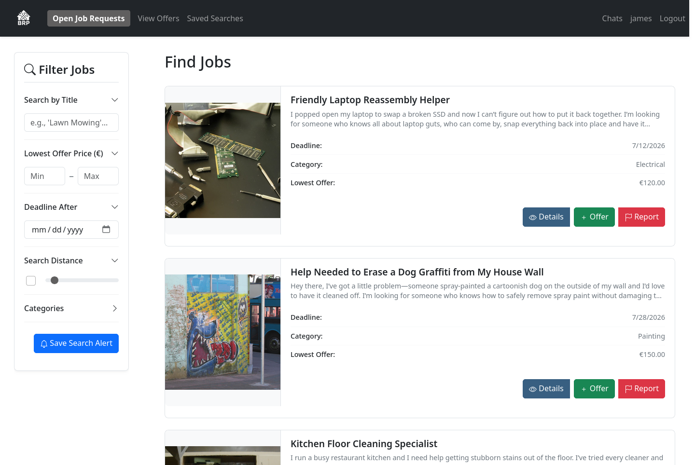
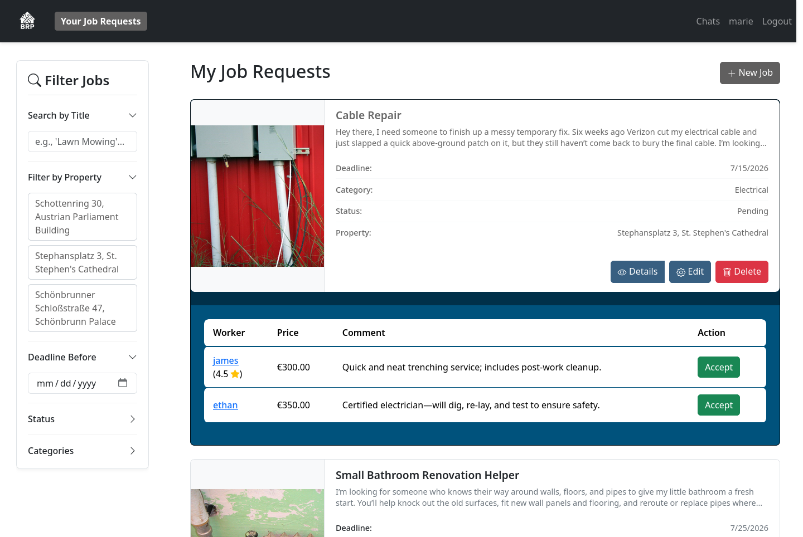
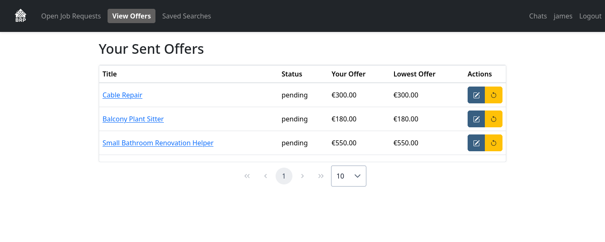
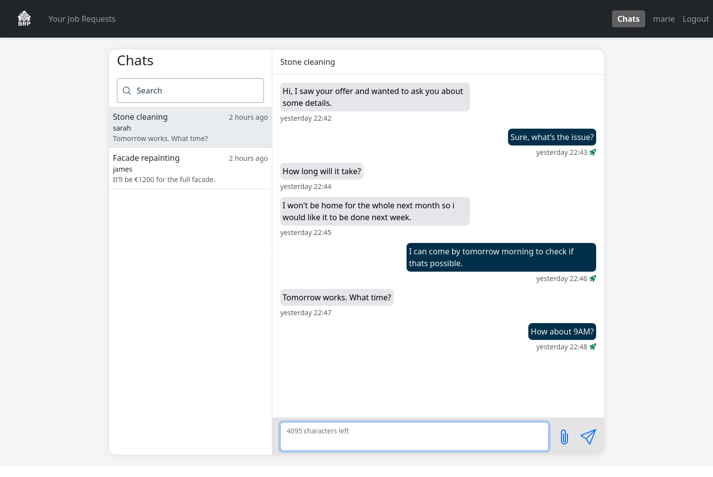

# RepairMarket

RepairMarket is a platform that connects customers with professional craftsmen for repair and installation services.

## Main features

Customers can post jobs, such as fixing a leaking pipe or installing a light, and add photos to explain what needs to be done.
Craftsmen can browse jobs, submit offers, and keep track of their offers.
Customers compare offers and choose a craftsman based on price, experience, and reviews.

Customers and craftsmen can chat directly to discuss the work and share details.
They can track the progress of a job and leave ratings and reviews after it is completed.
Craftsmen can also save searches to find jobs that match their interests.

Users can manage their profiles, and customers can save property addresses for their jobs.
Craftsmen can upload professional licenses for review.
Administrators review licenses, manage users and job posts, and handle reports from users.

## Screenshots

These screenshots show the application running with the generated sample data (`datagen` profile), using the `marie` customer and `james` craftsman accounts.

**Find repair jobs.** Craftsmen browse requests with photos, deadlines, categories, and prices, and filter jobs to find suitable work.



**Compare offers.** Customers manage their job requests and expand a job to compare craftsmen's prices, ratings, and comments before accepting an offer.



**Track submitted offers.** Craftsmen see their offers, their status, and the lowest competing price in one place.



**Discuss the work.** Customers and craftsmen use job-specific chats to agree on details and timing.



## Technologies

The frontend uses Angular and TypeScript, with Bootstrap and PrimeNG for the user interface.
The backend uses Java and Spring Boot, with Spring Data JPA and an H2 database to store data.
Spring Security and JWT handle authentication, and WebSockets support chat messages.

## Run with Docker

Install Docker with Docker Compose and start the Docker daemon. From the repository root, build and start the application:

```bash
docker compose up --build -d --wait
```

To start with sample data instead:

```bash
SPRING_PROFILES_ACTIVE=datagen docker compose up --build -d --wait
```

Sample logins are `marie` (customer), `james` (worker), and `tom` (administrator), all with password `12345678`.

## Run locally without Docker

Prerequisites: Java 21, Maven 3, and Node.js 22 with npm.

Run the backend and frontend in separate terminals. Start each terminal in the repository root.

### Backend

```bash
cd backend
mvn spring-boot:run
```

The backend runs at http://localhost:8080. It uses an embedded H2 database stored in `backend/database/`.

To start with sample data, use this command instead:

```bash
mvn spring-boot:run -Dspring-boot.run.profiles=datagen
```

Sample logins are `marie` (customer), `james` (worker), and `tom` (administrator), all with password `12345678`.

### Frontend

```bash
cd frontend
npm ci --legacy-peer-deps
npm start
```

Open http://localhost:4200 in your browser.
